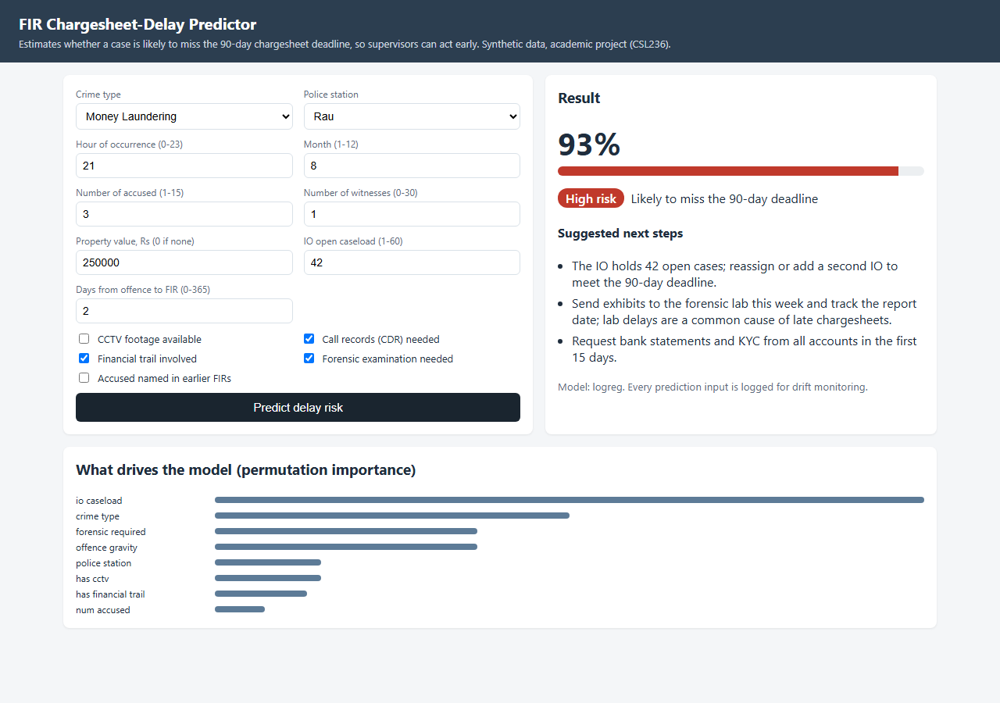
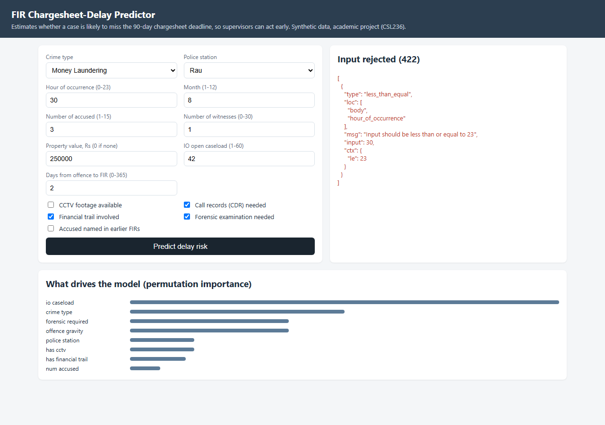
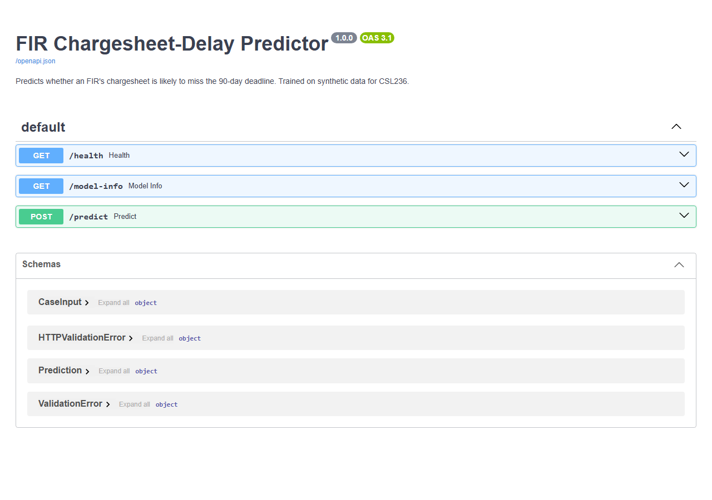
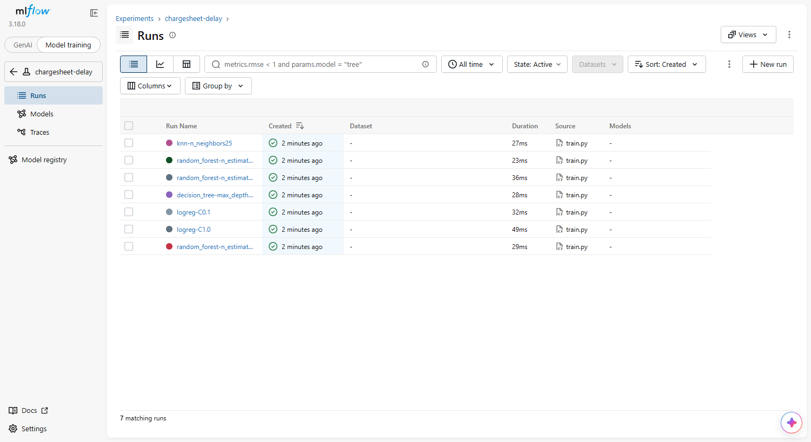
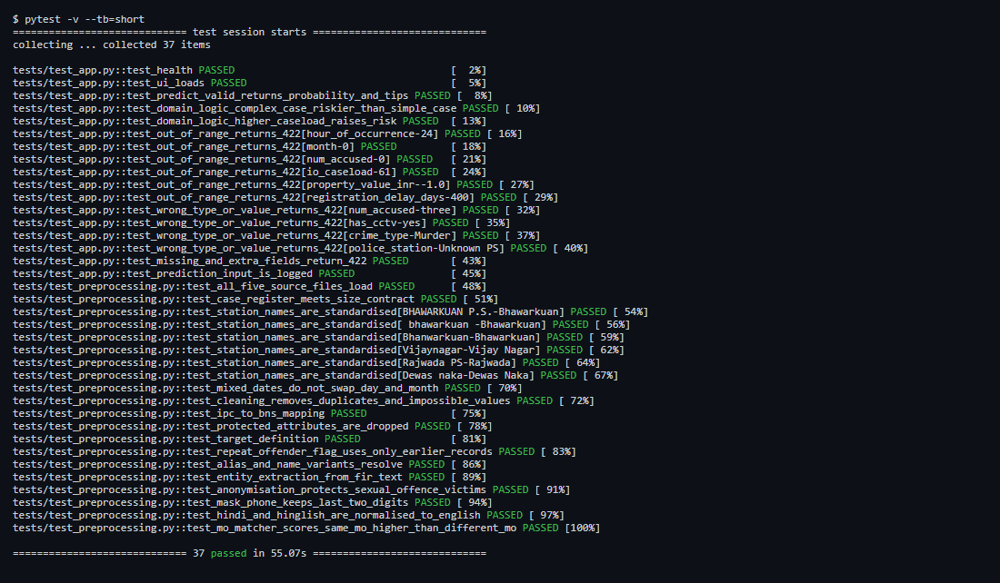
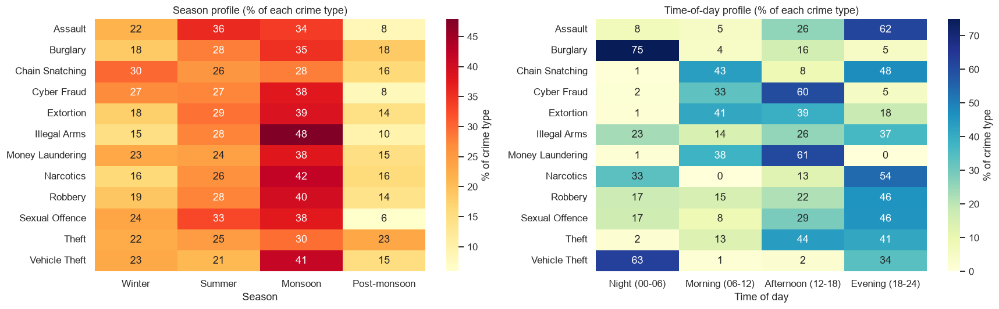
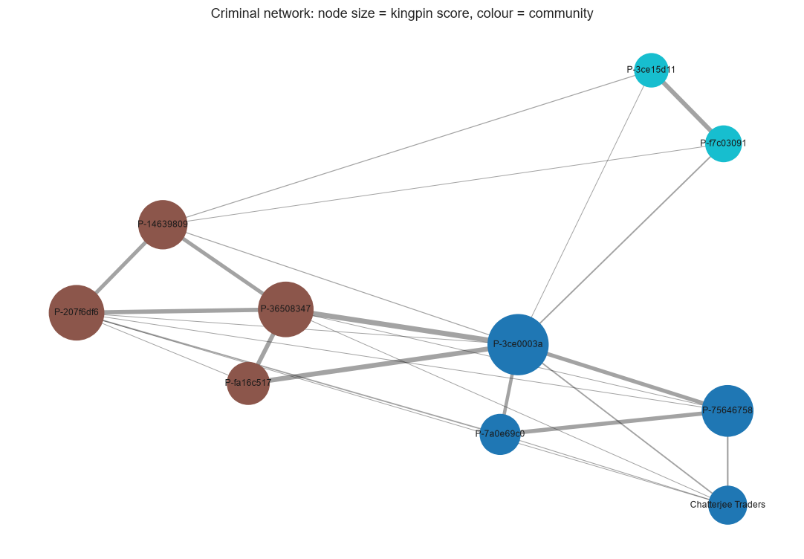
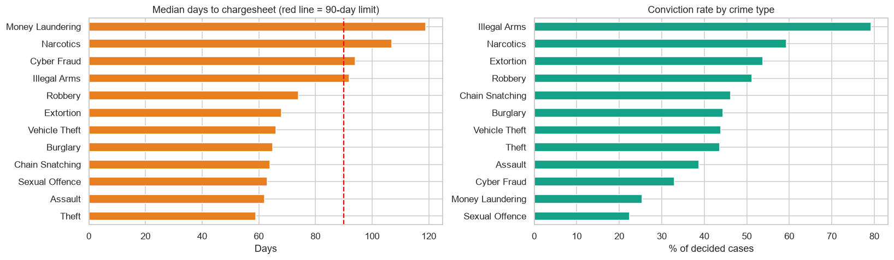

# FIR Crime Insights

[](https://colab.research.google.com/github/krishnabakshi/fir-crime-insights/blob/main/notebooks/FIR_Crime_Insights.ipynb)
[](https://github.com/krishnabakshi/fir-crime-insights/actions/workflows/ci.yml)
 

AI/ML system that reads FIR and criminal-record data and turns it into crime insights with ranked next steps:
crime trends, hotspot maps, modus-operandi (MO) matching across FIRs, criminal-network analysis, repeat-offender
records, case-progress tracking, short-term forecasts, and a deployed model that warns when a chargesheet is likely
to miss the 90-day deadline.

CSL236 Introduction to AI & ML, B.Tech CSE Semester 5, The NorthCap University. **All data is synthetic.**

---

## Contents
1. [Features](#features) · 2. [Screenshots](#screenshots) · 3. [Problem statement](#problem-statement) ·
4. [Dataset and data contract](#dataset-and-data-contract) · 5. [Models and why](#models-and-why-they-were-chosen) ·
6. [MLflow results](#mlflow-results) · 7. [Repository structure](#repository-structure) · 8. [Setup and usage](#setup-and-usage) ·
9. [Colab](#using-google-colab) · 10. [Deployment](#deployment-and-monitoring) · 11. [Git and GitHub](#create-the-github-repository) ·
12. [Ethics](#ethics-and-privacy) · 13. [Team](#team) · 14. [Limitations](#limitations-and-next-steps)

## Features

| Insight | Method | Output |
|---|---|---|
| Crime trends | Year-on-year change of the same months (removes seasonality); season and time-of-day profiles | Rise / fall by crime type and police station |
| Predictions | Weekly FIRs per station; Holt-Winters vs linear regression with seasonal terms vs naive mean, chosen by rolling backtest MAE | 4-week forecast and peak day / time per station |
| Hotspot mapping | K-Means + elbow method (patrol zones) and DBSCAN (dense hotspots, 250 m) on coordinates in km | Interactive folium map (`reports/hotspot_map.html`) |
| Pattern detection | Hindi / Hinglish normalisation, TF-IDF (word + character n-grams), optional multilingual embeddings, similarity within 45 days, dense groups = series | Linked FIRs for joint investigation |
| Network analysis | networkx graph from calls, money trail, FIR co-mentions, tips and co-accused; betweenness, PageRank, communities, Adamic-Adar, money loops, burst calls | Brokers, hidden links, layering loops |
| Repeat offenders | People named in several FIRs, from documented records only | Consolidation and history-sheet actions |
| Case progress | Pendency, overdue chargesheets, delay and conviction rates, IO workload + **supervised delay model** | Cases to prioritise now |
| Next steps | Rules turn every finding into Insight -> Evidence (FIR numbers) -> Suggested next step -> Priority | `reports/insights_report.html`, `reports/dashboard.html` |
| New FIRs | Same cleaning, then delay risk, MO match, accused on record, hotspot check | Per-FIR insights |

Example rows from `reports/insights_report.csv`:

| Priority | Insight | Evidence | Suggested next step |
|---|---|---|---|
| Critical | 66 investigations pending beyond 90 days without a chargesheet (20 beyond 180 days) | Oldest: BHK/0095/2025, BHK/0100/2025, ... | Prioritise chargesheets pending over 90 days: weekly review by SHO/ACP |
| Critical | 5 Extortion FIRs across 3 stations share the same MO (2 to 11 May 2026) | RJW/0047/2026, BHK/0054/2026, ...; MO "...men in vehicle MP09AB1234..." | Link FIR RJW/0047/2026 and FIR BHK/0054/2026 for joint investigation |
| Critical | Money moved in a closed loop (92% came back) | ACC1002 -> ACC1004 -> ACC1001 -> ACC1002 | Refer accounts for financial-intelligence analysis |
| High | 30 recent cases are likely to miss the 90-day chargesheet deadline | Model risk >= 0.70: VJN/0062/2026, S12/0044/2026, ... | Supervise now: fix IO timelines, fast-track forensic and CDR requests |

## Screenshots

| Prediction UI (`/`) | Invalid input rejected (422) |
|---|---|
|  |  |

| API docs (`/docs`) | MLflow runs |
|---|---|
|  |  |

| pytest | Charts from the notebook |
|---|---|
|  |  |

| Criminal network | Delay and conviction |
|---|---|
|  |  |

The green CI check and the live URL appear after the repository is pushed and deployed (see below).

## Problem statement

Police stations hold thousands of FIRs, but patterns across them (a gang working in several station areas, a rise
in one crime at one place, cases about to miss legal deadlines) are found late or not at all. This project builds a
pipeline that cleans and anonymises FIR and criminal-record data, finds those patterns, and writes ranked, evidence-
backed next steps for supervisors.

The deployed supervised model answers one question: **will this FIR's chargesheet be filed after 90 days?**
(binary classification). Knowing this at registration lets an SHO assign resources early instead of discovering
overdue cases later. It predicts about cases, never about people.

## Dataset and data contract

**Sources.** The five provided synthetic files in `data/synthetic/` (4 FIR / intelligence texts, 3 social-media tips,
18 call records, 8 criminal-history records, 8 financial transactions) plus `data/fir_cases.csv`, a 2,412-row FIR
case register generated by the documented, seeded script `data/generate_fir_cases.py` from the people, places and
modus operandi in those five files. Synthetic data generated with a documented script is allowed by the CSL236
end-term guidelines. Schemas and links between the files: [`data/README.md`](data/README.md).

Training rows: 2,139 labelled FIRs (2,400 after removing duplicates, minus 261 whose outcome is not yet known).
Target share: 34% delayed.

**Data contract** (enforced by the Pydantic schema in `app.py`; any violation returns HTTP 422):

| Feature | Type | Allowed range / values | Why it matters |
|---|---|---|---|
| `crime_type` | string (enum) | Theft, Vehicle Theft, Chain Snatching, Burglary, Robbery, Assault, Extortion, Cyber Fraud, Narcotics, Money Laundering, Illegal Arms, Sexual Offence | Complex offences (money laundering, cyber fraud, narcotics) take longer to investigate |
| `police_station` | string (enum) | Bhawarkuan, Rajwada, Chandan Nagar, Rau, Palasia, Vijay Nagar, Sector 12, Dewas Naka, Karol Bagh | Station workload and cross-jurisdiction cases differ |
| `hour_of_occurrence` | int | 0 - 23 | Binned into policing shifts (time of day) |
| `month` | int | 1 - 12 | Binned into season |
| `num_accused` | int | 1 - 15 | More accused means more arrests, statements and coordination |
| `num_witnesses` | int | 0 - 30 | Witness evidence speeds up investigation |
| `property_value_inr` | float | 0 - 50,000,000 | Large values signal complex financial cases (log-transformed) |
| `io_caseload` | int | 1 - 60 | Overloaded investigating officers file late (strongest signal) |
| `registration_delay_days` | int | 0 - 365 | Late FIRs often mean weaker evidence |
| `has_cctv` | bool | true / false | Video evidence shortens investigation |
| `has_cdr_evidence` | bool | true / false | Telecom data requests add waiting time |
| `has_financial_trail` | bool | true / false | Bank records add waiting time |
| `forensic_required` | bool | true / false | Forensic lab reports are a common cause of delay |
| `repeat_offender_involved` | bool | true / false | Accused already named in earlier FIRs (documented records) |
| `chargesheet_delayed` (target) | binary | {0, 1} | 1 = chargesheet filed or still pending after 90 days |

Derived inside the model: `offence_gravity` (ordinal Low < Medium < High from crime type), `season`, `time_of_day`.
Extra fields are rejected, so protected attributes such as caste or religion can never reach the model.

## Models and why they were chosen

| Task | Model | Why |
|---|---|---|
| Chargesheet delay (deployed) | **Logistic regression** (C = 0.1), compared with decision tree (GridSearchCV), random forest, KNN (CV over k) | Best cross-validated F1 on the training split, best ROC-AUC, fast, and its coefficients can be explained to a supervisor. Trees and forests were close but not better; KNN missed more delayed cases |
| Hotspots | K-Means (elbow) + DBSCAN | K-Means gives complete patrol zones; DBSCAN finds dense spots of any shape without choosing k and ignores scattered incidents |
| Forecast | Holt-Winters / linear regression with Fourier terms / naive mean | Weekly counts per station are small (about 2), so simple models chosen per station by backtest beat heavier ones such as Prophet |
| MO matching | TF-IDF + Hindi/Hinglish glossary (optional multilingual MiniLM embeddings) | Works offline on free Colab; the notebook compares both and keeps the one whose linked FIRs most often share a documented accused (TF-IDF: 80% vs 1% for random pairs) |
| Network | networkx centrality, communities, Adamic-Adar | Standard, explainable link-analysis measures |

F1 is the selection metric because only about a third of cases are delayed and missing a delayed case is costlier
than a false alarm. All learned preprocessing (group-wise median imputation, median / mode imputation, log1p,
StandardScaler, ordinal and one-hot encoding, variance filter) sits inside one sklearn `Pipeline` fitted on the
training split only.

## MLflow results

`python train.py --sweep` (test split = 428 FIRs; selection by 5-fold CV F1 on the training split):

| Run | Algorithm | Hyper-parameters | Accuracy | F1 | ROC-AUC | CV F1 |
|---|---|---|---|---|---|---|
| 1 | Logistic regression | C = 1.0 | 0.729 | 0.640 | 0.788 | 0.612 |
| 2 | **Logistic regression (selected)** | **C = 0.1** | **0.724** | **0.640** | **0.788** | **0.618** |
| 3 | Decision tree | max_depth = 5, min_samples_leaf = 20 | 0.687 | 0.573 | 0.727 | 0.560 |
| 4 | Random forest | n_estimators = 100, max_depth = 6 | 0.748 | 0.649 | 0.774 | 0.607 |
| 5 | Random forest | n_estimators = 300, max_depth = 10, min_samples_leaf = 5 | 0.729 | 0.633 | 0.771 | 0.616 |
| 6 | KNN | n_neighbors = 25 | 0.734 | 0.533 | 0.744 | 0.487 |

Random forest (run 4) has a slightly higher test F1, but the choice is made on cross-validated F1 so the test split
stays unbiased; the difference is within noise and logistic regression is simpler to explain. `mlflow.db` is
committed so evaluators can open the run history.

## Repository structure

```
fir-crime-insights/
├── README.md
├── LICENSE                         MIT
├── requirements.txt                full dev / training environment (pinned)
├── requirements-serve.txt          lean serving runtime (no MLflow / pytest / plotting)
├── .gitignore                      venv, mlruns, secrets, real data, restricted tables, logs
├── .gitattributes                  LF line endings (keeps the generated CSV byte-identical)
├── .dockerignore
├── Dockerfile                      python:3.11-slim serving image
├── app.py                          FastAPI app + Pydantic data contract
├── train.py                        training script with MLflow tracking
├── mlflow.db                       MLflow run history (SQLite)
├── .github/workflows/ci.yml        install -> check data generator -> train -> pytest -> docker build + smoke test
├── notebooks/
│   └── FIR_Crime_Insights.ipynb    complete Colab notebook (runs with Runtime > Run all)
├── data/
│   ├── README.md                   schemas and how the files link
│   ├── synthetic/                  the 5 provided synthetic files (never real data)
│   ├── generate_fir_cases.py       documented, seeded generator for the case register
│   └── fir_cases.csv               generated case register (2,412 rows x 31 columns)
├── src/
│   ├── contract.py                 shared constants and the feature contract (no heavy imports)
│   ├── data_loader.py              load from the repo / GitHub; structure report
│   ├── preprocessing.py            cleaning, merging, IPC-to-BNS, entity resolution, anonymisation
│   ├── trends.py                   trends, seasonality, forecasting
│   ├── hotspots.py                 K-Means zones, DBSCAN hotspots, folium map
│   ├── mo_matching.py              Hindi/Hinglish normalisation, TF-IDF / embeddings, series detection
│   ├── network_analysis.py         graph building, centrality, link prediction, money loops, repeat offenders
│   ├── case_progress.py            pendency, delays, conviction rates, IO workload
│   ├── model_pipeline.py           supervised delay model pipeline (used by notebook, train.py, app.py)
│   ├── insights_report.py          Insight -> Evidence -> Next step -> Priority, HTML report, dashboard
│   └── new_fir.py                  scoring newly registered FIRs
├── model/
│   ├── model.joblib                served model (from train.py)
│   └── metadata.json               metrics, feature importance, training statistics for drift
├── models/                         notebook artefacts and restricted identity table (git-ignored)
├── static/index.html               prediction UI with tips and feature importance
├── scripts/drift_check.py          compares logged inputs with training statistics
├── logs/sample_predictions.jsonl   sample prediction log (real logs are git-ignored)
├── reports/                        insight report, dashboard, map, network, figures
├── docs/                           guideline PDFs (git-ignored until sharing is allowed), screenshots
└── tests/
    ├── conftest.py
    ├── test_app.py                 health, UI, domain logic, 422 boundaries, logging (17 tests)
    └── test_preprocessing.py       cleaning, IPC-BNS, anonymisation, entity resolution, Hindi text (20 tests)
```

## Setup and usage

Requires Python 3.11 or 3.12.

```bash
python -m venv venv
source venv/bin/activate            # Windows PowerShell: venv\Scripts\Activate.ps1
pip install -r requirements.txt

python data/generate_fir_cases.py   # optional: rebuilds data/fir_cases.csv (identical, seed 42)
python train.py --n_estimators 100 --max_depth 6     # one random-forest run
python train.py --sweep                              # 6 runs, 4 algorithms, saves the best to model/model.joblib
mlflow ui --backend-store-uri sqlite:///mlflow.db    # http://localhost:5000

uvicorn app:app --reload --port 8000                 # UI http://localhost:8000, docs http://localhost:8000/docs
pytest -v --tb=short                                 # 37 tests
python scripts/drift_check.py --log logs/sample_predictions.jsonl
```

Example request:

```bash
curl -X POST http://localhost:8000/predict -H "Content-Type: application/json" -d '{
  "crime_type": "Money Laundering", "police_station": "Rau", "hour_of_occurrence": 12, "month": 8,
  "num_accused": 4, "num_witnesses": 0, "property_value_inr": 2500000, "io_caseload": 45,
  "registration_delay_days": 5, "has_cctv": false, "has_cdr_evidence": true,
  "has_financial_trail": true, "forensic_required": true, "repeat_offender_involved": true}'
```

Response: `delay_probability`, `predicted_delayed`, `risk_band` (High / Medium / Low), 2-3 `tips`, `model`.
`GET /model-info` returns metrics and permutation feature importance.

### Docker

```bash
docker build -t fir-crime-insights .
docker run -d -p 8000:8000 --restart unless-stopped fir-crime-insights
docker image ls fir-crime-insights        # note the image size here: ______ MB
```

The image installs only `requirements-serve.txt` and copies only `app.py`, `src/contract.py`,
`src/model_pipeline.py`, `model/` and `static/`.

## Using Google Colab

**Open from GitHub:** click the *Open in Colab* badge at the top, or go to <https://colab.research.google.com>,
choose *File > Open notebook > GitHub*, enter `krishnabakshi/fir-crime-insights` and pick
`notebooks/FIR_Crime_Insights.ipynb`. Then *Runtime > Run all*. The first code cell installs only missing libraries;
the second clones this repository so `src/` and the data are available. It runs on the free CPU runtime in a few
minutes (the optional multilingual embedding model is about 470 MB; set `FIR_USE_EMBEDDINGS=0` or
`USE_EMBEDDINGS = False` to skip it).

**Data options** (cell 1.1, `DATA_SOURCE`): `"repo"` (default), `"upload"` (upload the 5 files from your computer),
`"drive"` (copy them from `DRIVE_DATA_DIR` in Google Drive).

**Save changes back to GitHub:** *File > Save a copy in GitHub*, choose the repository and branch
(`main` or a new branch), write a commit message, keep *Include a link to Colaboratory* ticked, and press OK. Colab asks
for GitHub authorisation the first time. Outputs such as `reports/` are created inside the Colab session; download them
from the file panel or copy them to Drive if you want to keep them.

## Deployment and monitoring

Free-tier deployment on Render (any host that runs a Docker container works):
1. Push the repository to GitHub.
2. On <https://render.com>: *New > Web Service*, connect the repository, choose *Docker* as the runtime, free instance.
3. Render sets `$PORT`; the Dockerfile already listens on it. Health check path: `/health`.
4. Render restarts the container automatically if it stops (restart policy). Locally use `--restart unless-stopped`.

Every prediction input and output is appended to `logs/predictions.jsonl` (set another path with `PREDICTION_LOG`).
`scripts/drift_check.py` compares the mean of each numeric input with the training mean saved in
`model/metadata.json` and exits with code 1 when a feature moves by more than 0.5 training standard deviations,
which is the signal to retrain with `python train.py --sweep`.

## Create the GitHub repository

Run these from the `fir-crime-insights` folder (Windows PowerShell or any shell). Replace nothing except the
commit author if your teammates commit (every member must commit, per the guidelines).

```bash
git init -b main
git add .
git commit -m "FIR crime insights: notebook, src package, API, tests, Docker and CI"
```

Create the empty repository on GitHub (no README, no .gitignore), either at <https://github.com/new> with the name
`fir-crime-insights`, or with the GitHub CLI:

```bash
gh repo create fir-crime-insights --public --source . --remote origin --push
```

Or, if you created it on the website:

```bash
git remote add origin https://github.com/krishnabakshi/fir-crime-insights.git
git push -u origin main
```

After the first push, GitHub Actions runs `.github/workflows/ci.yml`; the green check appears on the commit in a few
minutes. Teammates clone the repository, work on a branch, and push:

```bash
git clone https://github.com/krishnabakshi/fir-crime-insights.git
git checkout -b feature/<what-you-change>
git add <files> && git commit -m "Describe the change"
git push -u origin feature/<what-you-change>
```

## Ethics and privacy

* **Synthetic only.** No real FIR or criminal-record data is in this repository. `.gitignore` blocks `data/real/`,
  `data/raw/`, `data/private/`, `*.real.csv`, secrets and the restricted identity table.
* **Anonymisation.** Accused and complainant names become salted pseudonyms; phones keep only the last two digits;
  addresses keep only the area. In **sexual-offence cases the victim and complainant identity is removed completely**
  and the address is reduced to the district (BNS section 72 / IPC 228A).
* **No profiling.** Caste, religion, community, tribe and ethnicity are never features (`drop_protected_attributes`,
  and the API rejects extra fields).
* **Records, not predictions, about people.** Repeat-offender and network insights use only documented FIRs and
  records. The model predicts case delays, never who "will" commit a crime. Hidden-link suggestions are marked
  "verify through field enquiry before recording any association".
* **Real deployment.** Keep data and the pseudonym salt (`FIR_PSEUDONYM_SALT`) in access-controlled, logged storage;
  follow the Digital Personal Data Protection Act 2023 and police data-handling rules; have an officer review every
  suggested action.

## Team

| Member | Roll number |
|---|---|
| Krishna Bakshi | 24CSU297 |
| Naman Sharma | 24CSU287 |

Both members must commit to this repository (the guidelines check commit history).

## Limitations and next steps

* The case register is synthetic, so results show that the pipeline works, not how real police data behaves; the
  model needs re-validation on real, approved data.
* The Hindi glossary covers common crime words only; a translation model (for example IndicTrans2) would cover more.
* Coordinates are approximate synthetic area centres.
* Next: real-time FIR ingestion, officer feedback on suggested links, and fairness audits across stations.

## References

scikit-learn, statsmodels, NetworkX, folium, FastAPI, MLflow and sentence-transformers documentation; Reimers and
Gurevych (2020) for the multilingual MiniLM model; Bharatiya Nyaya Sanhita 2023 and the MHA IPC-BNS correspondence
(verify before real use); CSL236 mid-term and end-term project guidelines.

## License

MIT, see [LICENSE](LICENSE).
